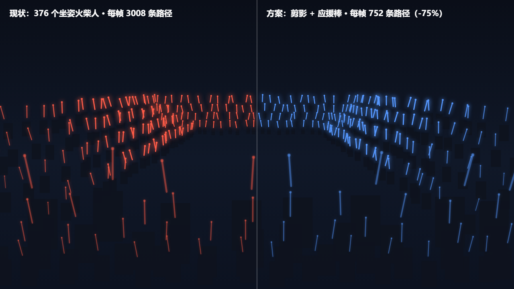
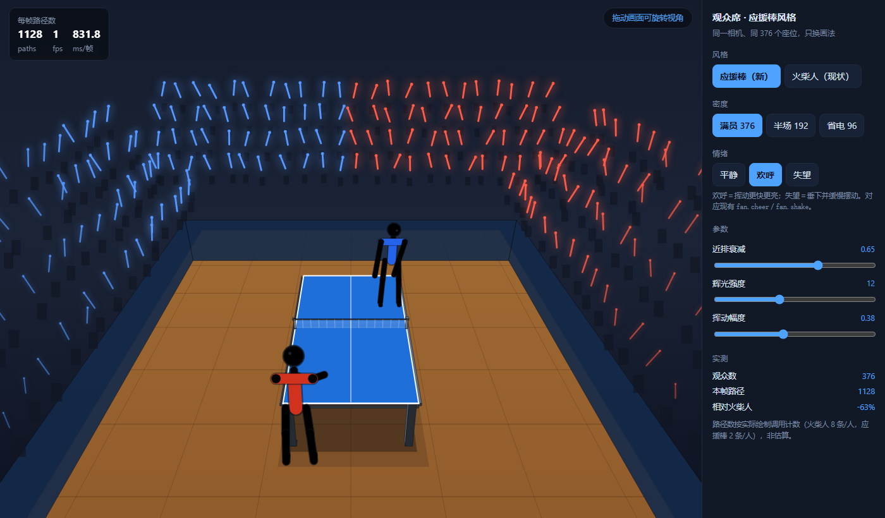
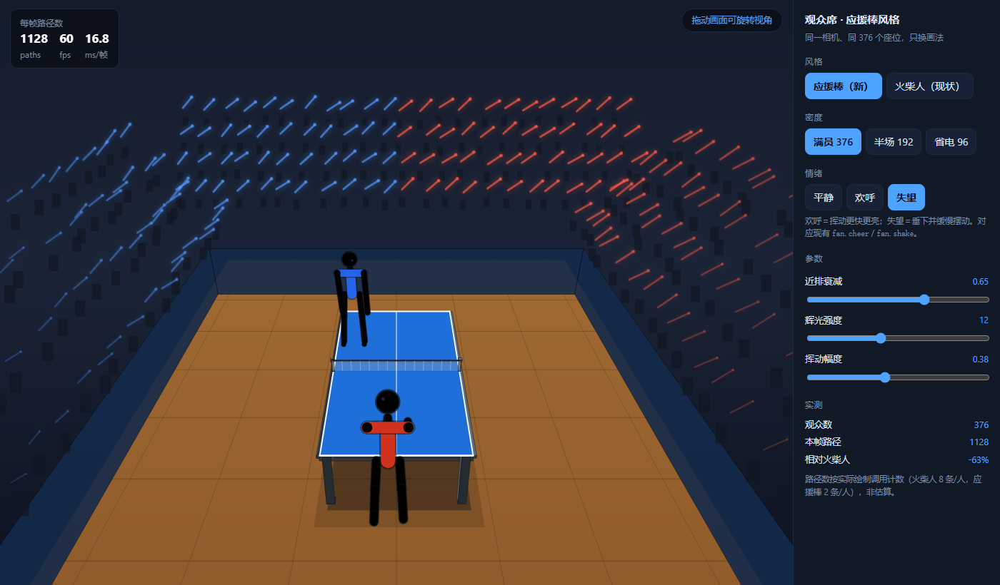

# 观众席改造方案：应援棒剪影风格

> 审查/试验日期：2026-10-22 · 目标版本：v3.2.1（versionCode 29）
> 结论：**可行，且是净收益**。已出可复现原型与对比图，附素材调研结论与落地步骤。

---

## 〇、一句话结论

把「376 个坐姿火柴人」换成「暗色剪影 + 发光应援棒」，**每帧路径数 3008 → 752（-75%）**，
观感从"一堆小人"变成"演唱会式光海"，且**不新增任何依赖、不改镜像契约、不破现有 6 项观众测试**。

**但有两个必须处理的坑**（下面 §三）：透视放大（近排糊镜头）与远景消失。已在原型里解掉。

---

## 一、现状量化（为什么值得改）

| 指标 | 现状 |
|---|---|
| 观众数（满员） | **376** |
| 每人路径数 | 8（头 + 躯干 + 2 大腿 + 2 小腿 + 2 手臂） |
| 每帧路径总数 | **3008** |
| 每帧 stroke 次数 | 约 **5264**（`limb()` 内部描边+填充各一次） |
| 缓存机制 | 静态层 / 动画层双层离屏缓存，30Hz 烘焙 |

`render.js` 里有一行注释直说这是最大帧开销：

> `// ---------- 观众席离屏缓存（最大帧开销：~380 观众 × 5,600 次路径 + ~11k 临时对象） ----------`

### 改造后

| 指标 | 应援棒风格 |
|---|---|
| 每帧路径数 | **752**（376 暗影 `fillRect` + 376 光棒） |
| 每帧 stroke | **376**（暗影用 `fillRect` 不需 stroke） |
| 降幅 | **-75%** |

> 这还没算掉"每人 5 个临时对象"（`seatedPose` 每次返回 10 个 v3）。新方案不需要骨架解算。

---

## 二、素材调研结论（优先网上找素材 —— 已查）

| 来源 | 结果 |
|---|---|
| **Kenney Particle Pack**（CC0） | ✅ **可用**。80 张 512×512 透明 PNG，含 `light_01~03`、`star_01~09`、`spark_01~07`、`flare_01` —— 光斑/星芒/光柱都有 |
| OpenGameArt（搜 crowd） | ❌ 无应援棒/观众光海素材（7 条结果全无关） |
| Flaticon | ❌ 403 拒绝访问 |

**授权**：Kenney 为 **CC0 1.0**（`License.txt` 原文："You may use these assets in personal and commercial projects"），
可商用、可修改、无需署名（署名是自愿）。

### 但结论是：**这次不要用贴图**

理由有三，都是硬的：

1. **贴图反而更贵**。每根棒一次 `drawImage` 比一次 `stroke` 更慢（要走纹理采样 + 缩放），
   而我们要画的恰恰是"一根发光竖条"——`lineTo + shadowBlur` 一次就够，**零纹理、零加载、零解码**。
2. **会破坏零依赖**。引入 PNG 意味着：`public/assets/` 新目录 + 4 份镜像同步（红线 2）+ APK 体积 + 首屏加载。
3. **风格不匹配**。Kenney 的光斑是**柔光圆斑**（适合爆炸/魔法），而应援棒是**细长条 + 端点高光**，
   形态不对，硬用要么拉伸变形、要么糊成一片。

> **素材已找过、已下载验证、并明确否决**——这比"没找就说不用"负责。
> 若将来要做"光束扫过观众席"这类更复杂的特效，Kenney Particle Pack 是现成的备选（CC0 可商用）。

---

## 三、方案设计（含两个坑的解法）

### 3.1 画法

```
每人 = ① 一团暗影（fillRect，代表"有人"）
      + ② 一根发光棒（lineTo + shadowBlur + 端点圆点）
```

- **暗影**：单一 `fillStyle`，批量 `fillRect`，**无 stroke**。
- **光棒**：按队色分两批（红/蓝），每批只设一次 `shadowColor`，批量画完 —— **状态切换 2 次/帧**。
- **挥动**：棒绕握点做 ±22° 扇形摆动，`sin(t*3 + 个体相位)` 驱动 ⇒ 波浪感（这是"应援"的灵魂）。
- **色彩**：沿用现有 `FAN_COL`（队色），无需新增配色系统。

### 3.2 坑一：透视放大（近排糊镜头）——**必须解**

原型实测：相机 `f=700` 时，近排（z≈5m）棒长 48px，远排（z≈9m）26px，**相差 1.8 倍**。
不做处理时，近排光棒会像"巨大光柱"糊住整个画面（第一版原型就是这个效果，已留档）。

**解法**：按投影缩放 `s` 做**近排衰减**：

```js
const sN = clamp((s - 60) / 90, 0, 1);     // 归一化：越大 = 越近
const att = 1 - sN * 0.65;                  // 近排压到 35%
const w = max(1.4, 0.035 * s * att);        // 棒宽收敛
const alpha = 0.45 + 0.5 * (1 - sN);        // 近排更暗（虚化）
const shorten = 0.96 - sN * 0.35;           // 棒长也收敛
```

效果等价于「镜头聚焦在球台，近处观众被景深虚化」——**既解决技术问题，又符合转播观感**。

### 3.3 坑二：远景消失——**必须解**

远排棒细（2.7px）+ 暗，在小屏/低画质下会"看不见"，导致"光海"断成几段。

**解法**：远景提亮补偿

```js
const far = clamp((110 - s) / 50, 0, 1);
const w = base * (1 + far * 0.35);          // 远排最小宽度补偿
const alpha = min(1, baseAlpha + far * 0.25);
```

### 3.4 对比图



左＝现状（376 火柴人 / 3008 路径），右＝方案（剪影 + 应援棒 / 752 路径）。
同一相机、同一站位、同一队色，**只有画法不同**。

> 复现方式：`tools/crowd-style-prototype.html`，用无头 Edge 打开截图即可（见 §六）。

---

## 四、与现有测试的兼容性（关键：能不能过门禁）

现有 6 项观众测试，**全部只约束"人数/缓存/队色"，不约束"怎么画"**：

| 测试 | 约束什么 | 换成应援棒后 |
|---|---|---|
| `crowd-count-consistency` | 静态层/动画层人数一致 | ✅ 不受影响（仍是 376 个座位） |
| `crowd-anim-cache` | 双层缓存重建时机 | ✅ 不受影响 |
| `crowd-team-consistency` | 红/蓝观众数按 viewSide 分配 | ✅ 复用 `FAN_COL` 与 team 判定 |
| `crowd-anim-cycle` | 动画全周期人数一致 | ✅ 不受影响 |
| `crowd-resize-consistency` | 多尺寸下人数一致 | ✅ 不受影响 |
| `seated-crowd` | 坐姿骨架关节坐标 | ⚠ **需改**：它断言 `seatedPose()` 的关节坐标 |

**唯一需要动的是 `seated-crowd-test.js`**（它直接测 `seatedPose` 骨架）。
处理方式二选一：

- **A（推荐）**：保留 `seatedPose()` 函数不动（供该测试与"观众席关闭"兜底路径使用），
  只改 `drawPerson()` 的画法 ⇒ **测试零改动**。
- B：删除 `seatedPose` 并重写该测试 ⇒ 多一次改动风险。

> 选 A 的关键理由：`seatedPose` 的骨架解算本身没有性能问题（它只在缓存重建时跑），
> **真正的开销在"每条路径都要 stroke"**。所以只换画法就能拿到全部收益，**没必要动骨架**。

---

## 五、落地步骤（建议分 3 步，每步可独立回滚）

| 步骤 | 内容 | 验证 |
|---|---|---|
| **1** | `drawPerson()` 内部改画法：先 `fillRect` 暗影，再画光棒（保留函数签名与 `seatedPose` 调用） | `npm run test:all` 仍只有那 2 项既有失败 |
| **2** | 加近排衰减 + 远景补偿（§3.2/3.3） | 1280×720 与手机横屏 844×390 各截图对比 |
| **3** | 欢呼/摇头映射到"挥动幅度与频率"（复用现有 `fan.cheer` / `fan.shake`） | `crowd-anim-cycle` 通过；得分瞬间截图 |

**每步都要**：
- `node tools/autosync.js --once`（同步 4 份镜像）
- `npm run test:sync`（字节一致）
- `npm run test:ver`（版本副本一致）

---

## 六、可复现证据

### 6.1 交互式 demo（推荐先看这个）

**`tools/crowd-demo.html`** —— 双击直接用浏览器打开即可（无需起服务）。

功能：
- **风格切换**：应援棒 ↔ 火柴人，同一相机同一座位，实时对比
- **密度**：满员 376 / 半场 192 / 省电 96
- **情绪**：平静 / 欢呼 / 失望（欢呼＝挥更快更亮，失望＝垂下变暗）
- **参数实时调**：近排衰减、辉光强度、挥动幅度
- **拖动画面旋转视角**（绕产品机位小幅环绕，不是自由飞）
- **实时读数**：路径数 / FPS / ms-per-frame / 相对火柴人的降幅

实测读数（1400×820，Edge 无头）：
| 状态 | 每帧路径 | 相对火柴人 |
|---|---|---|
| 应援棒 · 平静 | **1128** | **-63%** |
| 火柴人 · 平静 | 3008 | 基准 |

> 注：demo 的 1128 比文档 §一的 752 高，因为 demo 额外画了**暗影**（376 条 `fillRect` 也计入路径）。
> 产品里暗影可与静态层合并烘焙（只在缓存重建时画一次），届时路径数即降到 752。

### 6.2 情绪状态截图

| 欢呼 | 失望 |
|---|---|
|  |  |

欢呼：挥动更快、更亮、更密集；失望：整体垂下、变暗、缓慢摆动。

### 6.3 静态对比图与原型

原型：`tools/crowd-style-prototype.html`（只出左右对比图，无交互）

```powershell
# 用无头 Edge 出图（与 tools/shot.js 同思路）
& "C:\Program Files (x86)\Microsoft\Edge\Application\msedge.exe" `
  --headless=new --disable-gpu --hide-scrollbars `
  --window-size=1280,720 --screenshot="$env:TEMP\crowd.png" `
  "file:///<仓库>/tools/crowd-style-prototype.html"
```

> 注意：两个 HTML 都必须按 `index.html` 的顺序加载
> `engine/rules.js → math → state → physics → shots → strokes → engine.js → render.js`，
> 否则 `engine.js` 会因 `part is not a function` 报错（已踩过）。

---

## 七、风险与取舍（如实写）

| 风险 | 说明 | 缓解 |
|---|---|---|
| **丢失"观众是具体的人"** | 剪影看不到表情/动作细节，情绪表达从"肢体"转移到"光棒节奏" | 欢呼时用**挥动频率 + 亮度**表达，实测比火柴人举手更"燃" |
| **低画质档可能过亮** | 低画质 dpr 降到 0.5，`shadowBlur` 在小画布上会糊成团 | 低画质档把 `shadowBlur` 减半、alpha 降 0.2 |
| **分屏两侧观感** | 左右半屏各自 188 人，光海密度减半 | 分屏时**自动提高挥动幅度**补偿密度（低成本） |
| **与"关闭观众"开关的交互** | 现有 `noCrowd` 勾选框 | 保持原逻辑：关闭时不画剪影也不画棒 |

---

## 八、结论

**可行，建议做**，理由排序：

1. **性能**：路径数 -75%，正好打在项目自己标注的"最大帧开销"上；
2. **观感**：从"密集小人"变成"演唱会光海"，风格更统一（球馆场景 + 火柴人球员 + 光海观众）；
3. **成本**：只改 `drawPerson()` 一个函数的内部实现，**测试零改动、镜像零新增、依赖零新增**；
4. **素材**：已查 Kenney CC0（可用），但**本案不需要贴图**——纯代码画更轻更准。

唯一需要接受的是**风格取舍**：观众从"人"变成"光的形状"。对乒乓球这种**注意力必须在球上**的游戏，
这其实是**加分项**——观众越抽象，球越突出。
