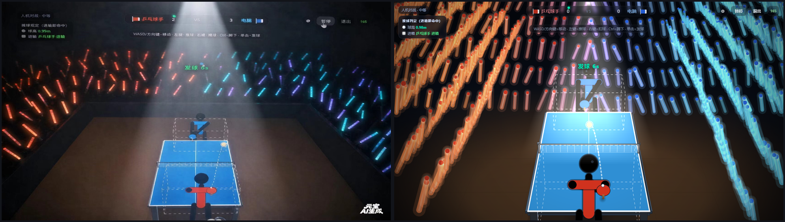
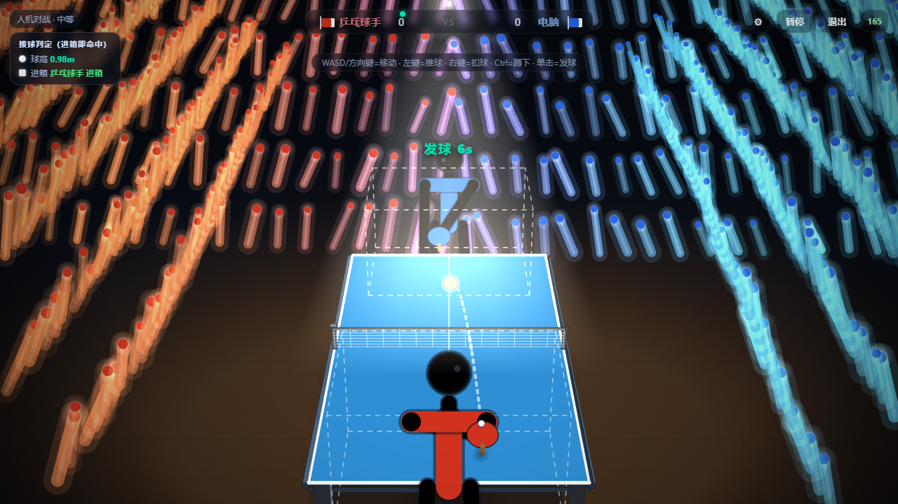
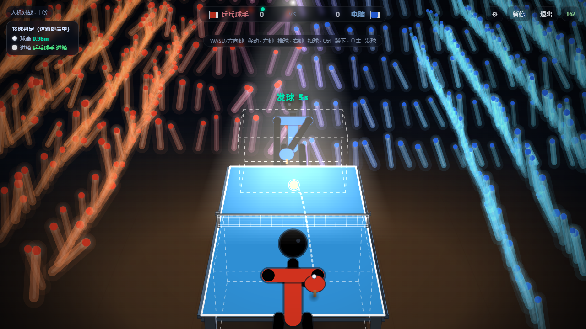

# 赛场画面总纲 · 落地说明（2026-10-22）

> 📌 状态：已被 `赛场画面落地说明_20261023.md` **取代**（那一版改为忠于参考图复刻）。本文仅作历史对照。

> 依据《乒乓赛场_总纲提示词》（用户提供的两份提示词）。本文只记"这一轮做了什么、参数在哪、怎么调"。
> 完整变更与验证读数见 [`../修改记录.md`](../修改记录.md) 同日条目。






---

## 〇、30 秒速览

| 总纲要求 | 落地情况 |
|---|---|
| 场地整体压暗、暗色竞技场 | ✅ 背景近黑、台面压暗、看台几乎不可见 |
| 头顶聚光灯单独打亮球台与球员 | ✅ 纵向压暗 + 体积光锥 + 球台所在区域恢复亮度 |
| 光锥边缘锐利、轻微体积雾 | ✅ 外锥淡（雾）+ 内锥亮（核心），全部 `lighter` |
| 观众只有棍状应援棒，不建模人物 | ✅ 极低透明度暗影 + 发光棒（原有路线保持） |
| 棒头亮、棒身渐暗、末端消失 | ✅ 三段棒身 + 白色细高光 |
| 朝向中心倾斜、倾角/长度/粗细/亮度全不同 | ✅ 每根独立 `lean/twist/len/thin/lum` |
| 左红右蓝、中间渐变过渡 | ✅ 按"离中心轴距离"插值，过渡带宽 2.1m |
| 四角暗角、远景景深、棒轻微虚化 | ✅ 暗角渐变 + 外圈"晕边"虚化 |
| 待机低频轻摆或纯呼吸 | ✅ 0.45 rad/s 低频 + 亮度呼吸，相位逐根随机 |
| 得分挥舞爆闪、光浪、对方压暗静止 | ✅ 4.4 rad/s + 爆闪 +55% + 光浪延迟；对方保留 20% |
| 庆祝短促、快速衰减 | ✅ 复用 `fan.cheer` 0.6/s 衰减（≈1.7s） |
| UI 半透明低调 | ✅ 比分条/提示/按钮/帧数全部降到底色 0.34~0.42 |
| 应援棒视觉权重低于球员 | ✅ 亮度上限低于球员，且外圈被景深压暗 |

---

## 一、参数在哪（改之前先看这张表）

全部在 `public/js/render.js`，**以函数名为准**（行号会漂）：

| 参数 | 位置 | 当前值 | 作用 |
|---|---|---|---|
| `LIGHT_AMB.darkTop/darkMid/darkBottom` | `LIGHT_AMB` | 0.80 / 0.30 / 0.62 | 纵向压暗：上缘 / 台面高度 / 近端地板 |
| `LIGHT_AMB.floor` 与 `floorNear/floorFar` | `LIGHT_AMB` | 1.0 / `132,82,38` / `158,104,54` | 地板色与亮度 |
| `LIGHT_AMB.volCenter/volEdge` | `LIGHT_AMB` | 0.115 / 0.058 | 体积光内锥 / 外锥强度 |
| `LIGHT_AMB.volBottom` | `LIGHT_AMB` | 0.62 | 光锥落到的画面高度比例 |
| `LIGHT_AMB.vigSide/vigCorner` | `LIGHT_AMB` | 0.30 / 0.82 | 四边 / 四角暗角 |
| `CROWD_FX.len/thin` | `CROWD_FX` | 0.66 / 0.078 | 棒长 / 棒身半径基准 |
| `CROWD_FX.lean/jitter` | `CROWD_FX` | 0.42 / 0.62 | 朝中心倾角 / 个体抖动 |
| `CROWD_FX.idleSwing/idleSpeed/breath` | `CROWD_FX` | 0.055 / 0.45 / 0.16 | 待机摆幅 / 频率 / 亮度呼吸 |
| `CROWD_FX.cheerSwing/cheerSpeed/cheerFlash` | `CROWD_FX` | 0.62 / 4.4 / 0.42 | 庆祝摆幅 / 频率 / 爆闪 |
| `CROWD_FX.cheerOther` | `CROWD_FX` | 0.20 | 对方阵营庆祝期亮度保留比 |
| `CROWD_FX.wave` | `CROWD_FX` | 1.0 | 光浪速度（越小越快） |
| `CROWD_FX.baseAlpha` | `CROWD_FX` | 0.86 | 常规亮度（**上限应低于球员**） |
| `CROWD_FX.dofNear/dofFar/dofMax` | `CROWD_FX` | 0.30 / 0.55 / 0.85 | 景深虚化强度 |
| `TEAM_BAND` | `crowdLayout` 之前 | 2.1 | 红蓝过渡带宽度（m） |
| 侧看台步长 | `crowdLayout()` | `0.21 / d` | 侧看台密度 |
| 端看台步长 | `crowdLayout()` | `0.26 / d` | 端看台密度 |
| 看台条带透明度 | `drawBenches` | 0.022 | 看台可见度 |

**开关**：`TTG.setCrowdStyle('stick'|'figure')`、`TTG.setLightingMode('both'|'world'|'overlay'|'off')`。

---

## 二、分层结构（为什么这样画）

```
drawFloor（离屏缓存，相机/尺寸/开关变化才重建）
  ├─ drawFloorBg      背景渐变 + 地板椭圆渐变 + 格线
  ├─ drawBenches      看台条带（几乎不可见）
  ├─ drawCrowd(侧看台)  ← skipEnd
  ├─ drawLighting('world')  纵向压暗
  └─ drawCrowd(端看台)  ← endOnly（不压暗：它是"光源墙"）

drawScene（每帧）
  ├─ …球员/球台/球…
  └─ drawLighting('overlay')  四角暗角 + 体积光 + 灯位
```

**得分动画期**：静态层不含观众，观众改由动画层（30Hz）绘制；
动画层内部顺序与静态层**完全一致**（侧看台 → `source-atop` 压暗 → 端看台），
否则一得分画面就会变样（这个坑上一轮踩过，本轮又踩了一次，已修）。

---

## 三、怎么调（常用追问对应的改法）

| 想要的效果 | 改哪里 |
|---|---|
| 光锥太宽/太窄 | `LIGHT_AMB.volCenter` 的 `vw * 0.048/0.135`（内锥顶/底半宽） |
| 体积雾太浓 | `LIGHT_AMB.volEdge`（外锥强度） |
| 场地还不够黑 | `LIGHT_AMB.darkTop`（看台）与 `darkBottom`（近端地板） |
| 台面太暗/太亮 | `LIGHT_AMB.darkMid` 与 `C.tableTop` |
| 暗角太重 | `LIGHT_AMB.vigCorner` |
| 棒太粗/太长 | `CROWD_FX.thin` / `CROWD_FX.len` |
| 棒太整齐 | `CROWD_FX.jitter`（倾角抖动）与 `ensureStickFields()` 里的 `len/thin/lum` 区间 |
| 过渡带太硬 | `TEAM_BAND` 调大（过渡更宽更柔） |
| 待机还在抖 | `CROWD_FX.idleSwing` 调小、`idleSpeed` 调低（0.3 以下接近"纯呼吸"） |
| 庆祝太持久 | 不改这里：`public/js/app/loop.js` 的 `dt * 0.6` 衰减系数 |
| 光浪太快/太慢 | `CROWD_FX.wave`（调大更慢） |
| 外圈太虚/太实 | `CROWD_FX.dofNear`（近排）/ `dofFar`（远排） |

---

## 四、怎么验收（不用开浏览器手点）

```powershell
# 真实对局截图 + 帧率 + 上半屏亮像素占比（桌面 + 手机横屏）
node tools/arena-game-shot.cjs %TEMP%\arena

# 自由机位批量出图（离线调参）
node tools/arena-shot.cjs %TEMP%\shots "density=0.5" "density=0.5&fan=cheer"

# 只跑观众席 6 项
node test/seated-crowd-test.js
node test/crowd-count-consistency-test.js
node test/crowd-anim-cache-test.js
node test/crowd-team-consistency-test.js
node test/crowd-anim-cycle-test.js
node test/crowd-resize-consistency-test.js
```

> 三个工具都依赖 `playwright-core`（优先仓库 `node_modules`，其次借全局 `@playwright/cli`），
> 找不到时打印 `SKIP` 并以 0 退出——不会把门禁弄红。

---

## 五、已知遗留 / 已否决

**遗留**
- 未重建 APK、未升版本号（手机端要拿到新赛场需走一次 `android/build.cmd` + `set-version`）。
- 顶部聚光灯没有"扫场"模式；得分时不扫灯。
- 低画质档（`low`）恒为无观众、无灯光层。
- 火柴人模式（`setCrowdStyle('figure')`）没有暗场适配，它是调试/兜底路径。

**已否决**
- `ctx.filter = 'blur()'` 做景深：逐图元离屏模糊，667 根/帧直接掉帧。
- `shadowBlur` 做辉光：同上（历史上 60→46fps）。
- 整片贴图观众：会打破"每人 1 次 `arc`"的计数口径与 6 项测试。
