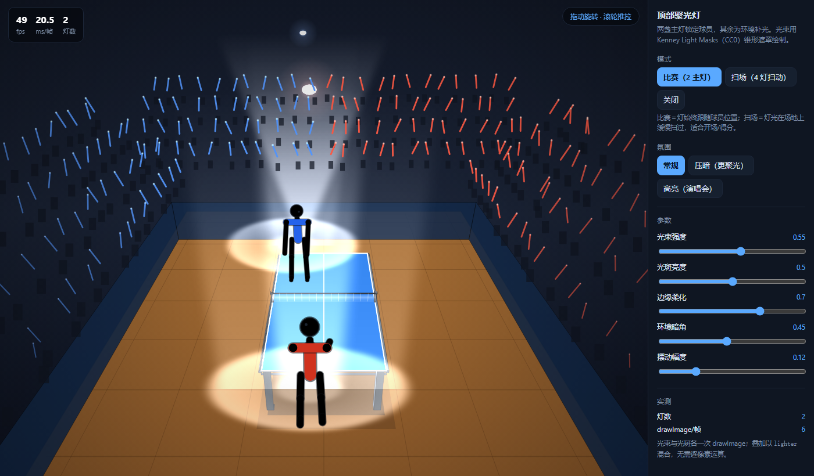
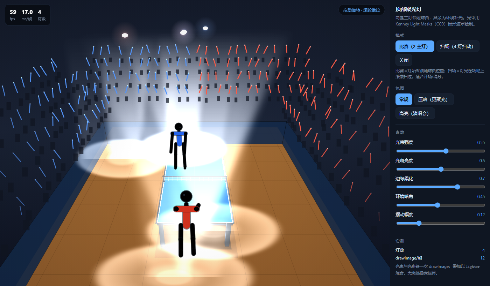

# 顶部聚光灯 · 赛场氛围方案

> 日期：2026-10-22 · 基线：v3.2.1（versionCode 29）· 目标：烘托赛场氛围，聚光聚焦两位球员
> 结论：**可行**，纯 Canvas 2D 实现，零新增运行时依赖；素材用 Kenney Light Masks（CC0）。

---

## 〇、一句话

用 **3 层叠加**做出聚光灯：**光束（锥形遮罩）+ 地面光斑（椭圆遮罩）+ 环境压暗（径向渐变）**，
全部走 `lighter` 混合，2 盏灯每帧只有 **6 次 `drawImage`**，不碰像素级运算。

演示：**`tools/spotlight-demo.html`**（双击即开）

---

## 一、素材（优先网络找 —— 已找到并验证）

| 来源 | 结果 |
|---|---|
| **Kenney Light Masks** | ✅ **采用**。150 张 512×512 透明 PNG，含 **32 张 cone（锥形光柱）**、28 张 circle（圆形光斑）、12 张 fan（扇形） |
| Kenney Particle Pack | 备选（已下载验证），光斑更"圆润"，不如 Light Masks 的锥形精准 |
| OpenGameArt | ❌ 无对应素材 |

**授权**：CC0 1.0（`License.txt` 原文："You may use these assets in personal and commercial projects"），
可商用、可改、无需署名。仓库内留了 `tools/demo-assets/License-Kenney-LightMasks.txt` 存证。

**实际用到 4 张**（共 135KB）：

| 文件 | 用途 |
|---|---|
| `cone_composed_a.png` | 红方光束（上窄下宽、上暗下亮） |
| `cone_composed_b.png` | 蓝方光束（带柔边） |
| `circle_a.png` | 红方地面光斑 |
| `circle_b.png` | 蓝方地面光斑 |

> 下载踩坑：`kenney.nl` 的 TLS 证书吊销检查在本机离线，`curl` 报
> `CRYPT_E_REVOCATION_OFFLINE`。解法：`curl --ssl-no-revoke`。**不是网络不通，别去改 DNS/代理**。

---

## 二、三层结构（缺一不可）

```
① 光束   锥形贴图，从灯位(4.2m)拉伸到地面目标，'lighter' 叠加
② 光斑   圆形贴图，按透视压扁成椭圆（y 压缩 0.42），'lighter' 叠加
③ 压暗   径向渐变，中心透明、四周变黑 —— 这一层才产生"聚光"的对比感
```

**为什么必须有第 ③ 层**：只有光束和光斑时，画面整体亮度不变，看起来像"加了几个亮斑"，
而不是"灯光打下来"。压暗层把光斑以外压黑，视觉上才有"被照亮"的感觉。

### 关键实现：透视压扁

光斑不能画成正圆——地面是俯视的，正圆会像"平放的盘子"。按相机俯角压扁：

```js
const rx = radius * p.s;       // 横向半径（按投影缩放）
const ry = rx * 0.42;          // 纵向压扁（俯视角的余弦近似）
```

### 关键实现：灯具本体

光束必须有"来源"。`drawLamp()` 画一个小亮芯 + 光晕（程序化，不依赖贴图）。
**世界半径要极小（0.05m）**——灯在 4.2m 高处、离相机仅约 4m，投影缩放 `s≈150`，
用 0.16m 会画成一个占满画面的"蘑菇"（踩过）。

---

## 三、模式与参数

| 模式 | 行为 | 用途 |
|---|---|---|
| **比赛（2 主灯）** | 灯锁定两位球员，带小幅滞后摆动（像真人追灯） | 常规对局 |
| **扫场（4 灯）** | 灯光在场地上按不同频率扫过 | 开场 / 得分 / 结算 |
| 关闭 | 不画灯光 | 低配 / 省电 |

| 参数 | 默认 | 说明 |
|---|---|---|
| 光束强度 | 0.55 | `globalAlpha` |
| 光斑亮度 | 0.50 | 同上 |
| 边缘柔化 | 0.70 | 预留给贴图外的额外模糊（当前由贴图自带） |
| 环境暗角 | 0.45 | 第 ③ 层强度；"压暗"模式 +0.28，"高亮"模式 −0.30 |
| 摆动幅度 | 0.12 | 主灯跟随球员时的滞后摆动 |

---

## 四、性能：两处必须知道的坑

### 坑一：`shadowBlur` 是逐图元高斯模糊

第一版观众席应援棒用 `ctx.shadowBlur = 12` 做辉光，**376 根棒 = 376 次离屏模糊**，
帧率从 60 掉到 46。

**解法**：预烘焙一张 64×64 径向渐变光斑，按棒端点 `drawImage`。
每帧只是位图拷贝（GPU 加速），开销低一个数量级。

### 坑二：循环里切换 `globalCompositeOperation` 会刷新渲染状态

第二版把「棒身 + 光斑」写在同一循环里，每次都要 `lighter → source-over → lighter`，
376 次状态切换，帧率仍上不去。

**解法：分两批画**——先整批画棒身（`source-over`），再整批画光斑（`lighter`），
**每批只切一次**。

### 实测（无头 Edge，1400×820，软件渲染）

| 配置 | FPS |
|---|---|
| 初版（shadowBlur + 循环内切混合） | 46 |
| 预烘焙光斑 + 分两批 | **49~59** |
| 扫场 4 灯 | 59 |

> 注：无头 Edge 是**软件渲染**，读数比真机 GPU 低不少。真机上 `drawImage` 走 GPU 纹理拷贝，
> 预期显著高于此值。要真实读数需在带 GPU 的浏览器里看 demo 的 HUD。

---

## 五、与现有架构的兼容性

| 关注点 | 结论 |
|---|---|
| 新增运行时依赖 | **无**（贴图仅 demo 用，产品若接入只需 4 张 PNG ≈ 135KB） |
| 渲染栈 | 仍是 Canvas 2D，无 WebGL |
| 镜像 | 产品接入时需同步 4 份（红线 2），但**只新增绘制调用，不改现有函数** |
| 排序 | 光束画在球员**之前**、观众**之前**（光在空间里，人在光里）；压暗画在最上层 |
| 测试 | 现有 `crowd-*` 测试不涉及灯光；若接入产品需新增 1 条"灯光绘制不抛错"冒烟 |
| 低画质档 | 建议：低画质关掉光束（只留光斑 + 压暗），省 2 次大图 `drawImage` |

---

## 六、演示

**`tools/spotlight-demo.html`** —— 双击打开。

- 三种模式切换（比赛 / 扫场 / 关闭）
- 三种氛围（常规 / 压暗 / 高亮）
- 五个参数实时可调
- **拖动旋转 · 滚轮推拉**
- HUD 实时显示 FPS / ms / 灯数 / drawImage 次数

### 截图

| 比赛模式 | 扫场模式（高亮） |
|---|---|
|  |  |

---

## 七、落地建议（若接入产品）

| 步骤 | 内容 | 风险 |
|---|---|---|
| 1 | 新增 `public/js/lighting.js`，导出 `drawLights(ctx, cam, view)` | 低（纯新增） |
| 2 | `drawScene` 里在 `drawTable` 之后、球员之前插入 | 低 |
| 3 | 4 张 PNG 放 `public/assets/light/`，`autosync` 同步 4 份镜像 | 中（红线 2） |
| 4 | 设置面板加「灯光」开关；低画质自动降级为"只留光斑" | 低 |
| 5 | 得分/开局时切"扫场" 2 秒 | 低 |

> 若不想引入 PNG（保持零依赖），可用**程序化锥形渐变**替代——
> demo 里已写好回退分支（`img` 为 null 时走 `createLinearGradient` + 多边形）。
> 观感略逊于贴图，但零素材、零加载。

---

## 八、已否决

- **用 `shadowBlur` 做光束**：376 次逐图元模糊，帧率不可接受。
- **光斑画正圆**：俯视下像"平放的盘子"，必须按 0.42 压扁。
- **灯位放 6.5m**：相机 4.8m 高，会把灯投到画面外，只剩一根无源白柱。
- **只画光束不画压暗**：没有对比就没有"聚光感"，看起来只是"加了几个亮斑"。
